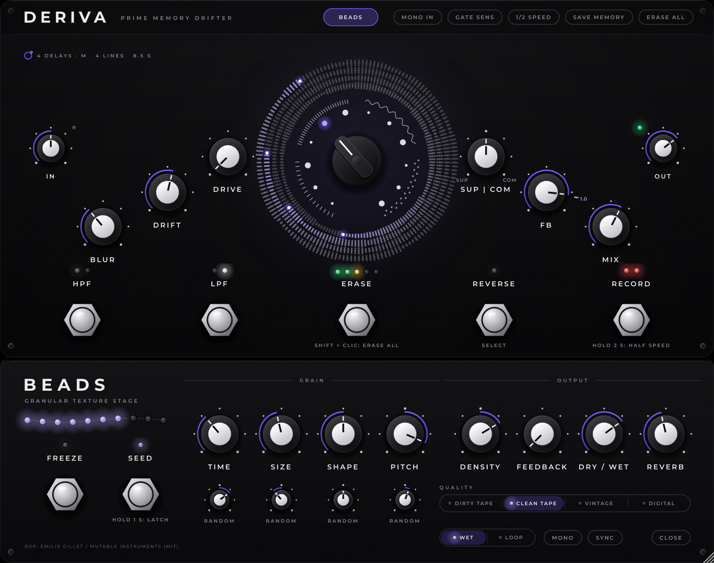

# Deriva — prime memory drifter

*English version: [README.md](README.md)*

Plugin VST3 para Linux que reproduce el funcionamiento del firmware principal del SOMA Laboratory COSMOS. Su núcleo es una memoria de 44,7 s repartida en líneas de retardo de longitud prima que derivan unas respecto a otras. Nombre, código e interfaz son propios; no usa material de SOMA.



## Instalación

Descarga el zip de tu sistema en la página de *Releases* del repositorio y copia la carpeta `Deriva.vst3` en:

| Sistema | Carpeta |
| --- | --- |
| Linux | `~/.vst3/` (o `/usr/lib/vst3/`) |
| Windows | `C:\Program Files\Common Files\VST3\` |
| macOS | `~/Library/Audio/Plug-Ins/VST3/` (o `/Library/Audio/Plug-Ins/VST3/`) |

Después vuelve a escanear los plugins en el DAW (en REAPER: *Options → Preferences → Plug-ins → VST → Re-scan*).

- **Linux:** x86_64, glibc 2.35 o posterior (Ubuntu 22.04+, Debian 12+, Fedora 35+, Arch…), fontconfig y freetype.
- **Windows:** 10 u 11 de 64 bits. El runtime de Visual C++ va incluido.
- **macOS:** 10.13 o posterior; binario universal (Apple Silicon e Intel). El plugin no está firmado por Apple: si macOS lo bloquea, ejecuta `xattr -dr com.apple.quarantine ~/Library/Audio/Plug-Ins/VST3/Deriva.vst3`.

El manual completo, en castellano e inglés, está en `docs/manual/`.

## Algoritmos (selector central)

| Pos. | Algoritmo | Líneas | Tiempo |
| --- | --- | --- | --- |
| 1–3 | 2 DELAYS · S / M / L | 2 primas (L y R) | 2,5 / 9,5 / 22 s |
| 4–6 | 4 DELAYS · S / M / L | 4 primas | 2,5 / 8,5 / 11,5 s |
| 7–9 | REVERB · HUGE / SUPER / INSANE | FDN de 8 líneas | línea mayor 1,1 / 2,6 / 5,3 s |
| 10–12 | GRAIN · S / M / L | 2 (L: +1 central) | granos 45 / 140 / 380 ms |

Al cambiar de algoritmo la memoria no se borra: el nuevo algoritmo reinterpreta el mismo contenido. El cambio hace un fade-out y un fade-in de 30 ms y suaviza los puntos de unión con fundidos de 3 ms.

Las **órbitas** alrededor del selector muestran cada línea de memoria: su contenido como envolvente y su cabezal como punto morado. Como las líneas miden números primos distintos, los cabezales se separan poco a poco; esa es la «deriva».

## Controles

| Control | Función |
| --- | --- |
| IN | Ganancia de entrada (±24 dB). LED verde con señal, rojo si satura. |
| BLUR | Delays: realimentación cruzada ortogonal entre líneas. Granular: posición de grano con ruido. Reverb: sin efecto. |
| DRIFT | Delays: paneo de cada línea con LFO asíncrono modulado por un atractor de Lorenz. Granular: posición de grano. Reverb: sin efecto. |
| DRIVE | Saturación tanh con antialiasing ADAA en la entrada a la memoria. |
| SUP / COM | Izquierda: supresor (lo nuevo sustituye a lo grabado). Centro: apagado. Derecha: compresor detectado sobre memoria + entrada. |
| FB | Realimentación de 0 a 1,15. La marca 1.0 indica la ganancia unidad, donde la memoria se mantiene. Por encima crece hasta el limitador tipo cinta. |
| MIX | Seco / memoria. En el centro ambos salen a 0 dB. |
| OUT | Nivel de salida. |

Doble clic en un knob lo devuelve a su valor por defecto. El medidor de 5 LEDs mide el nivel dentro del bucle y el LED rojo indica que actúa el limitador.

### Pulsadores

| Pulsador | Clic | Clic derecho / rueda | Otros |
| --- | --- | --- | --- |
| HPF | on / off | 60 / 150 / 400 Hz | Filtro dentro del bucle. |
| LPF | on / off | 1,5 / 4 / 9 kHz (MIN = el más oscuro) | Filtro dentro del bucle. |
| ERASE | mantener = borra en los cabezales | — | Mayús + clic = ERASE ALL |
| REVERSE | on / off | — | Invierte lo grabado y lo que entra, como la cinta. |
| RECORD | graba sí / no | grupo 1 / grupo 2 / todos | Mantener 2 s = media velocidad (solo delays) |

Los LEDs dobles indican la opción elegida (izquierdo = MIN o grupo 1, derecho = MED o grupo 2, ambos = MAX o todos). Brillan con la función activa y se ven tenues con ella apagada.

Los chips de arriba sustituyen a las combinaciones ocultas del hardware: **MONO IN**, **GATE SENS** (gate 20 dB más sensible), **1/2 SPEED**, **SAVE MEMORY** y **ERASE ALL**.

## Etapa BEADS

El botón **BEADS** (arriba, junto a los chips) abre un panel debajo y activa la etapa granular de Beads, de Mutable Instruments. Al pulsarlo otra vez, o con **CLOSE**, se cierra y Beads queda en bypass; la entrada y la salida usan un fundido de 30 ms. El DSP es el original de Emilie Gillet (MIT) y funciona siempre a 48 kHz. Si el host va a otra frecuencia, se remuestrea con r8brain; esa ruta añade entre 5 ms (a 48 kHz) y unos 30 ms (a 44,1 o 96 kHz) solo a la señal de la memoria.

| Control | Función |
| --- | --- |
| TIME / SIZE / SHAPE / PITCH | Posición en el buffer de 4 s, duración (por debajo de 1/3 los granos suenan al revés; al máximo, modo delay), envolvente y transposición (±24 st con paradas en 1, 3, 4, 7, 12 y 24). |
| RANDOM (×4) | Aleatoriedad de cada uno: a la derecha, salto aleatorio por grano; a la izquierda, deriva suave. |
| DENSITY | En el centro no hay granos. A la izquierda, granos aleatorios; a la derecha, regulares. |
| FEEDBACK / DRY/WET / REVERB | Realimentación propia de Beads, mezcla y reverb Griesinger / Dattorro. |
| FREEZE | Congela el buffer de Beads. |
| SEED | Enclavado (LED latiendo): granos continuos. Pulsar: modo manual, cada pulsación dispara granos. Mantener 1 s: se vuelve a enclavar. |
| QUALITY | DIRTY TAPE (8 bits µ-law, 24 kHz, wow y flutter), CLEAN TAPE (12 bits, 24 kHz), VINTAGE (12 bits, 32 kHz) o DIGITAL (16 bits, 48 kHz). |
| WET / LOOP | WET: Beads procesa la salida de la memoria antes de MIX. LOOP: la realimentación de Deriva pasa por Beads, en la proporción que marca DRY/WET, y cada repetición se vuelve a granular. En LOOP se anulan el FEEDBACK y la REVERB de Beads. |
| MONO | Buffer mono, con el doble de tiempo. |
| SYNC | Reloj de negras del host conectado a la entrada SEED. Con SEED enclavado, DENSITY elige divisor y probabilidad. |

### MIDI (cualquier canal)

- **Notas:** 60 HPF · 61 LPF · 62 ERASE (momentáneo) · 63 REVERSE · 64 RECORD · 65 ERASE ALL · 66 HALF SPEED · 67 FREEZE (Beads) · 68 SEED (momentáneo) · 69 BEADS on/off.
- **CC:** 20 IN · 21 BLUR · 22 DRIFT · 23 DRIVE · 24 SUP|COM · 25 FB · 26 MIX · 27 OUT · 28 algoritmo · 29 TIME · 30 SIZE · 31 SHAPE · 32 PITCH · 33 DENSITY · 34 FEEDBACK · 35 DRY/WET · 36 REVERB (Beads).

### Guardar la memoria

Con **SAVE MEMORY** activado, el contenido de la memoria se guarda en el proyecto en 16 bits comprimidos (unos 3–4 MB a 48 kHz). Si el proyecto se abre a otra frecuencia de muestreo, se remuestrea. Si la frecuencia de muestreo cambia mientras el plugin está cargado, la memoria se vacía.

## Diferencias con el hardware

- Incluye los 12 algoritmos del firmware principal. Los firmwares rítmico, pitch y quad no están (todavía).
- La reverb no tiene la deriva de afinación que se ha documentado en el foro de SOMA.
- Las combinaciones ocultas son chips visibles, y la pulsación larga de RECORD dura 2 s en lugar de 5.
- Lo que SOMA no documenta está estimado: valores exactos de los primos, frecuencias de filtros, curvas de limitador, supresor y compresor, y tamaños de grano. Todo está en `Source/dsp/Engine.h` para afinarlo de oído.

## DSP y referencias

- **Líneas de cinta con un solo puntero fraccionario** de lectura y escritura: D. Rocchesso, *Fractionally-addressed delay lines*, IEEE TSAP 8(6), 2000 (DAFx-98). Con velocidad 1 los cabezales están en celdas enteras, así que la lectura es exacta y no se acumula filtrado en cada pasada.
- **Interpolación Hermite de 4 puntos** para media velocidad, reverse y granos: O. Niemitalo, *Polynomial Interpolators for High-Quality Resampling of Oversampled Audio*, 2001.
- **BLUR**: rotaciones de Givens ortogonales, que a 45° equivalen a una Hadamard normalizada. Conservan la energía, de modo que FB = 1,0 mantiene el nivel con cualquier BLUR. Bases: M. Gerzon, 1976; J.-M. Jot y A. Chaigne, 1991; J. O. Smith, *Physical Audio Signal Processing*; G. Luff, *Let's write a reverb* (Signalsmith, 2021).
- **Giant Reverb**: FDN de 8 líneas primas con matriz Householder (poca difusión, así que los primeros ecos se oyen separados) y dos allpass de Schroeder sin pérdidas por línea dentro del bucle, para que se fundan despacio.
- **Filtros**: SVF TPT / ZDF (V. Zavalishin, *The Art of VA Filter Design* 2.1; A. Simper).
- **DRIVE**: tanh con ADAA de primer orden (J. Parker, V. Zavalishin y E. Le Bivic, DAFx-16; S. Bilbao et al., IEEE SPL 2017).
- **DRIFT**: LFOs con proporciones irracionales (1, √2, φ, √3…) cuya velocidad modula un atractor de Lorenz lento.

- **Beads**: código original de `pichenettes/eurorack` (beads/dsp) y `stmlib`, con los cambios mínimos anotados en `ThirdParty/mi/README-Deriva.txt`. Funciona a 48 kHz en bloques de 32 muestras. El remuestreo usa r8brain-free-src (A. Vaneev) con banda de transición del 6 %, 120 dB de atenuación y fase lineal.

Pruebas: `tests/engine_test.cpp` (motor) y `tests/beads_test.cpp` (Beads: flujo sin cortes a 44,1, 48, 88,2 y 96 kHz con bloques aleatorios, tono exacto, latencia, leyes de los controles y reloj). La prueba del motor incluye:

- conservación de energía con FB = 1,0 durante 150 s;
- limitador con FB = 1,15;
- 100 cambios de algoritmo sin clics;
- octava exacta a media velocidad;
- los 12 algoritmos;
- ERASE ALL;
- distintas frecuencias de muestreo.

El VST3 pasa **pluginval** al nivel de exigencia 10.

## Compilar

```bash
# JUCE 8.0.10 se descarga automáticamente (o usa -DJUCE_DIR=/ruta/a/JUCE)
cmake -B build -G Ninja -DCMAKE_BUILD_TYPE=Release
# macOS universal: añade "-DCMAKE_OSX_ARCHITECTURES=arm64;x86_64"
cmake --build build
# resultado: build/Deriva_artefacts/Release/VST3/Deriva.vst3
# (las versiones de Linux, Windows y macOS se compilan en GitHub Actions: .github/workflows/build.yml)
g++ -std=c++17 -O2 -o engine_test tests/engine_test.cpp && ./engine_test
```

Dependencias en Debian/Ubuntu: `libx11-dev libxext-dev libxinerama-dev libxrandr-dev libxcursor-dev libxcomposite-dev libxi-dev libfreetype-dev libfontconfig1-dev libasound2-dev`.

## Licencias

- El código usa JUCE 8, disponible con licencia AGPLv3 o comercial. Si distribuyes el plugin sin licencia comercial de JUCE, el código debe publicarse bajo AGPLv3.
- La fuente Montserrat se usa bajo la SIL Open Font License (`Resources/fonts/OFL.txt`).
- El DSP de Beads y stmlib son © Emilie Gillet, con licencia MIT (`ThirdParty/mi/LICENSE-stmlib.txt`). r8brain-free-src es © Aleksey Vaneev, también MIT (`ThirdParty/r8brain/LICENSE`).
- «Beads» y «Mutable Instruments» se usan como referencia. Si vas a distribuir el plugin públicamente, conviene renombrar el panel.
- SOMA, COSMOS y Vlad Kreimer se mencionan solo como referencia funcional.
