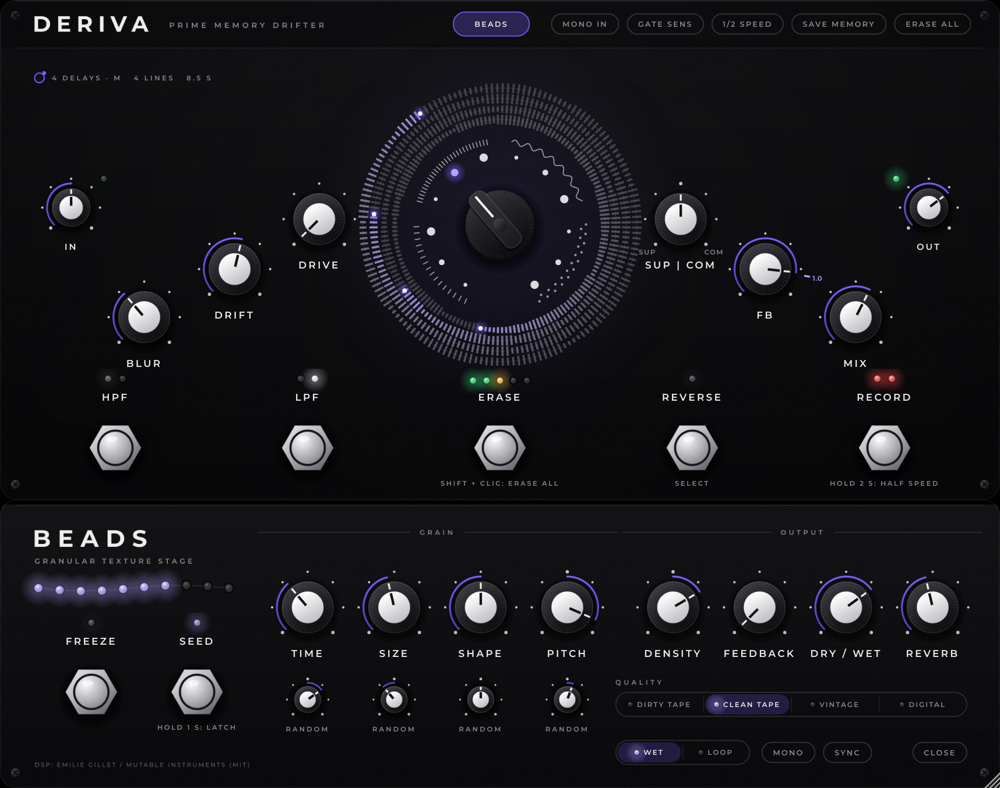

# Deriva — prime memory drifter

*Versión en castellano: [LEEME.md](LEEME.md)*

Deriva is a VST3 plugin for Linux, Windows and macOS that reproduces the behaviour of the main firmware of the SOMA Laboratory COSMOS: 44.7 seconds of sound memory split into delay lines whose lengths are different prime numbers. Because the lines never realign, recorded sounds keep recombining into an ever-changing texture. An optional **BEADS** stage adds the original granular DSP of Mutable Instruments Beads (by Émilie Gillet, MIT licence).

Name, code and interface are original; no SOMA material is used.



## Download and install

Get the zip for your system from the **Releases** page and copy the `Deriva.vst3` folder to:

| System | Folder |
| --- | --- |
| Linux | `~/.vst3/` (or `/usr/lib/vst3/`) |
| Windows | `C:\Program Files\Common Files\VST3\` |
| macOS | `~/Library/Audio/Plug-Ins/VST3/` (or `/Library/Audio/Plug-Ins/VST3/`) |

Then rescan plugins in your DAW.

- **Linux:** x86_64 with glibc 2.35 or newer (Ubuntu 22.04+, Debian 12+, Fedora 35+, Arch…), plus fontconfig and freetype.
- **Windows:** 10 or 11, 64-bit. The Visual C++ runtime is built in.
- **macOS:** 10.13 or newer, universal binary (Apple Silicon and Intel). The plugin is not notarised by Apple: if macOS blocks it, run `xattr -dr com.apple.quarantine ~/Library/Audio/Plug-Ins/VST3/Deriva.vst3`.

## Documentation

The full user manual (history, concept, every control, algorithms, Beads stage, MIDI map, recipes and technical notes) is in [`docs/manual/`](docs/manual), in English and Spanish.

## Overview

- **12 algorithms**: 2 delays, 4 delays, giant reverb and granular delay, each in three sizes.
- **Controls**: IN, BLUR, DRIFT, DRIVE, SUP|COM, FB (with unity mark), MIX and OUT, plus HPF, LPF, ERASE, REVERSE and RECORD footswitches.
- **Extras**: mono input sum, sensitive gate, half speed, save the memory with the project, erase all, full MIDI control.
- **Memory orbits**: a ring per delay line around the selector shows its content and its drifting head.
- **BEADS stage**: grains placed on the memory output (WET) or inside Deriva's feedback loop (LOOP). Includes TIME, SIZE, SHAPE and PITCH with randomness, DENSITY, FEEDBACK, DRY/WET, REVERB, FREEZE, SEED, four quality modes and host-tempo SYNC.

## Building

```bash
# JUCE 8.0.10 is fetched automatically (or pass -DJUCE_DIR=/path/to/JUCE)
cmake -B build -DCMAKE_BUILD_TYPE=Release
cmake --build build --config Release --target Deriva_VST3
# macOS universal binary: add "-DCMAKE_OSX_ARCHITECTURES=arm64;x86_64"
```

Linux packages (Debian/Ubuntu): `libx11-dev libxext-dev libxinerama-dev libxrandr-dev libxcursor-dev libxcomposite-dev libxi-dev libfreetype-dev libfontconfig1-dev libasound2-dev`.

The three platforms are built by GitHub Actions (`.github/workflows/build.yml`). Pushing a `v*` tag publishes a release with the zips and the manuals.

Offline DSP tests live in `tests/engine_test.cpp` and `tests/beads_test.cpp`; CI runs them on every push.

## Credits and licences

- It uses JUCE 8, which is available under AGPLv3 or a commercial licence.
- Beads DSP and stmlib: © Émilie Gillet (Mutable Instruments), MIT. Local changes are listed in `ThirdParty/mi/README-Deriva.txt`.
- r8brain-free-src: © Aleksey Vaneev, MIT.
- Montserrat font: SIL Open Font License.
- SOMA, COSMOS, Mutable Instruments and Beads are trademarks of their owners and are named only as functional references.
